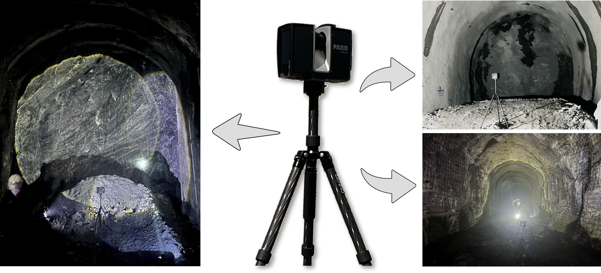

<h1 align="center">Multimodal Fracture Benchmark</h1>

<p align="center">
  
</p>

<p align="center">
  <a href="LICENSE"></a>
  <a href="https://www.python.org/"></a>
  <a href="https://pytorch.org/"></a>
  <a href="https://pan.baidu.com/s/126nPYeZ9rNuWBssg7RO2tg"></a>
  <a href="https://huggingface.co/xufengnian001/multimodal-fracture-benchmark"></a>
</p>

A benchmark for pixel-level crack segmentation on tunnel surfaces. Each sample is a 1024×1024 perspective view with an aligned color image, binary mask, visibility map, instance ids, depth, a depth-derived contrast map, and, where a crack is present, a tangent orientation field.

Reference baselines train from the color image and the binary mask. The other modalities are in the release for methods that use them.

## Installation

Python 3.9 or newer.

```bash
git clone --recurse-submodules https://github.com/rockstudio-1/Multimodal-Fracture-Benchmark.git
cd Multimodal-Fracture-Benchmark
pip install -e .
```

If the clone was not recursive:

```bash
git submodule update --init --recursive
```

Training and inference need PyTorch and the dependencies of the baseline you run:

```bash
pip install -e ".[train]"
```

Install the requirements of the baseline you train. Extra packages and pretrained initializers are listed in [docs/baselines.md](docs/baselines.md).

## Dataset

Download the dataset from Baidu Netdisk and extract it to `dataset/`:

[3DFractureDataset](https://pan.baidu.com/s/126nPYeZ9rNuWBssg7RO2tg)

The extraction code will come soon.

The archive is one directory of aligned modalities, not one folder per scan. `dataset/index.json` lists every sample and its `train` or `val` split.

```
dataset/
  index.json
  images/         {stem}_rgb.png        color
  masks/          {stem}_mask.png       binary crack, 0 or 255
  confidence/     {stem}_conf.png       255 visible, 25 occluded, 0 background
  ids/            {stem}_id.png         uint16 instance id, 0 is background
  depth/          {stem}_depth.png      uint16 millimeters, 0 is invalid
  depth_valid/    {stem}_dvalid.png     255 valid, 0 invalid
  geom/           {stem}_geom.npy       float32 local contrast
  vectors/        {stem}_vec.npy        (cos 2θ, sin 2θ), crack images only
```

File types, the three-class label rule, and checksums are in [dataset/README.md](dataset/README.md).

```bash
python -m fracturebench check
```

```python
from fracturebench.data import load_index, load_patch, select_patches

sample = load_patch("dataset", select_patches(load_index("dataset"), split="val")[0])
```

`sample["label"]` is 0 background, 1 visible crack, 2 occluded crack.

## Model zoo

Baseline checkpoints are on Hugging Face: [xufengnian001/multimodal-fracture-benchmark](https://huggingface.co/xufengnian001/multimodal-fracture-benchmark).

```bash
pip install -U huggingface_hub
huggingface-cli download xufengnian001/multimodal-fracture-benchmark <file> --local-dir checkpoints
python scripts/infer.py --model <name> --ckpt checkpoints/<file> --split val --out runs/<name>/preds
```

## Evaluation

Predictions are PNG masks named `{stem}.png`. A pixel is positive when its value is greater than zero. Masks are resized with nearest neighbors to the ground-truth resolution. Scores are micro-averaged: counts are summed over the split, then each ratio is computed once. If both the prediction and the ground truth contain no positive pixels, the corresponding score is 1. If only one side is empty, overlap that requires agreement is 0.

```bash
python scripts/evaluate.py \
    --pred-dir runs/<name>/preds \
    --split val \
    --output runs/<name>/metrics.json
```

`--split` is `train`, `val`, or `all`. `--tolerance-radius` defaults to 2. `--skeleton-iterations` defaults to 5. The JSON report contains `iou`, `dice`, `precision`, `recall`, `tolerance_f1`, and `cldice`.

Let $TP$, $FP$, and $FN$ be the true-positive, false-positive, and false-negative counts.

$$
\mathrm{IoU}=\frac{TP}{TP+FP+FN},\qquad
\mathrm{Dice}=\frac{2\,TP}{2\,TP+FP+FN}
$$

$$
\mathrm{Precision}=\frac{TP}{TP+FP},\qquad
\mathrm{Recall}=\frac{TP}{TP+FN}
$$

Tolerance F1 allows a boundary shift of radius $r$. $D_r$ is dilation by a square window of Chebyshev radius $r$ (default $r=2$). $P$ and $G$ are the predicted and ground-truth crack sets.

$$
\mathrm{Precision}_{r}=\frac{\left|P\cap D_r(G)\right|}{\left|P\right|},\qquad
\mathrm{Recall}_{r}=\frac{\left|G\cap D_r(P)\right|}{\left|G\right|}
$$

$$
\mathrm{Tolerance\text{-}F1}_{r}
=\frac{2\,\mathrm{Precision}_{r}\,\mathrm{Recall}_{r}}{\mathrm{Precision}_{r}+\mathrm{Recall}_{r}}
$$

clDice compares soft skeletons. $S(\cdot)$ is the iterative soft skeleton of Shit et al. (CVPR 2021), run for 5 iterations by default.

$$
T_{\mathrm{prec}}=\frac{\left|S(P)\cap G\right|}{\left|S(P)\right|},\qquad
T_{\mathrm{sens}}=\frac{\left|S(G)\cap P\right|}{\left|S(G)\right|},\qquad
\mathrm{clDice}=\frac{2\,T_{\mathrm{prec}}\,T_{\mathrm{sens}}}{T_{\mathrm{prec}}+T_{\mathrm{sens}}}
$$

## Repository layout

```
configs/benchmark.yaml     reference hyperparameters
dataset/                   manifest and, after download, the image archive
docs/                      baseline notes
fracturebench/             loaders, metrics, prepare / train / infer / evaluate
scripts/                   command-line entry points
tests/                     metric unit tests
third_party/               upstream baselines (git submodules)
```

Generated layouts go to `work/`. Training outputs go to `runs/`. Some baselines write checkpoints inside their own repository instead.

## Testing

```bash
python -m unittest discover -s tests -t .
```

## License

Code in this repository is under the [Apache License 2.0](LICENSE). Each baseline remains under the license shipped in its submodule. The dataset is distributed separately on Baidu Netdisk for research and benchmark comparisons.

## Citation
